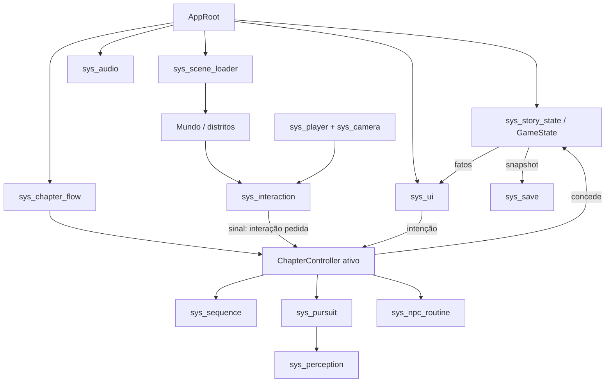

# 17 — Arquitetura técnica

> **Estado:** planejamento. Nenhum projeto de engine foi criado para este jogo. Recursos específicos do Godot 4.7.2 citados como "spike" precisam de verificação prática antes de virarem contrato. Nenhum número de desempenho aqui é medido.

## 1. Escolha da engine

### 1.1. Contexto que pesa na decisão

* A pasta-mãe `VHB/` já contém `tools/godot/4.7.2/` (editor portátil e templates de exportação oficiais da mesma versão) e um projeto em produção, **The Dunwich Horror**, desenvolvido nessa versão com GDScript tipado e renderizador Compatibility, com export Windows funcional (`builds/The Dunwich Horror/`).
* Esse projeto já resolveu, de forma revisada, problemas que este jogo também terá: save com versão de esquema, backup e migração em memória; opções persistentes; remapeamento de teclado; leitor de documentos com fonte ajustável; legendas; pausa que congela simulação; diários com dicas graduais; cenas de validação isoladas.
* O jogo é de baixa fidelidade deliberada (D-018): a vantagem gráfica de Unreal e do HDRP/URP de ponta é pouco relevante.
* O desenvolvimento é assistido por Claude Code: formatos de texto (`.tscn`, `.tres`, `.gd`) legíveis e diffáveis são uma vantagem concreta.

### 1.2. Matriz de decisão

Notas de 1 (pior) a 5 (melhor) **para este projeto**, não como juízo universal. Peso × nota = pontos.

| Critério (§20) | Peso | Godot 4.7.2 | Unity 6 (URP) | Unreal 5 |
|---|---:|---:|---:|---:|
| Viabilidade de desenvolvimento com Claude Code (formatos texto, CLI, headless) | 5 | 5 | 3 | 2 |
| Ferramenta já instalada e validada no estúdio | 4 | 5 | 1 | 1 |
| Renderização retrô (resolução reduzida, nearest, shaders simples) | 4 | 4 | 4 | 3 |
| Iluminação adequada ao estilo (vertex color, poucas luzes, névoa) | 3 | 4 | 5 | 5 |
| Facilidade de produzir NPCs roteirizados | 3 | 4 | 4 | 4 |
| Sistemas de diálogo/documentos (feitos sob medida) | 2 | 4 | 4 | 3 |
| Animação (esqueleto simples, blend básico) | 3 | 3 | 5 | 5 |
| Navegação (navmesh para patrulhas pequenas) | 2 | 4 | 4 | 5 |
| Desempenho em PC modesto | 3 | 4 | 4 | 2 |
| Organização modular (cenas, Resources) | 3 | 5 | 4 | 3 |
| Exportação Windows | 3 | 4 | 5 | 4 |
| Licenciamento e custo | 4 | 5 | 3 | 3 |
| Complexidade para equipe de 1–3 pessoas | 4 | 5 | 3 | 2 |
| Manutenção de longo prazo / fixação de versão | 3 | 4 | 3 | 3 |
| **Total ponderado** | **46** | **205** | **172** | **146** |

Justificativas por coluna:

* **Godot:** licença MIT sem royalties; editor portátil já presente; cenas e scripts em texto; execução headless para testes de lógica (como no projeto Dunwich). Fragilidades: ferramentas de animação e iluminação baked menos maduras que Unity/Unreal; ecossistema de assets menor.
* **Unity:** ótima animação, iluminação baked e loja de assets; porém instalação nova, termos de licença historicamente instáveis, formatos de cena YAML grandes e menos amigáveis a edição automatizada, e nenhuma base existente no estúdio.
* **Unreal:** excelente para fidelidade alta, que o projeto não busca; build pesado, C++/Blueprints pouco adequados à edição textual, royalties acima de limiar de receita, curva alta para equipe pequena.

### 1.3. Decisão (D-001)

**Godot 4.7.2 Standard, GDScript tipado, renderizador Compatibility, export Windows x86_64**, editor e templates da mesma versão, a partir de `VHB/tools/godot/4.7.2/` ou cópia fixada no próprio projeto (Q-004).

Condições:

* Trocar renderizador (ex.: Forward+ ou Mobile) exige spike documentado (`INN-016`) e decisão registrada; nunca por conveniência.
* Atualizar versão da engine exige justificativa, branch/cópia separada e teste de migração.
* Reaproveitar código do projeto Dunwich é **decisão pendente** (Q-005). Até lá, ele serve de **referência de padrões**, não de dependência: nenhum caminho deste projeto aponta para `VHB/game/`.

### 1.4. Spikes técnicos obrigatórios antes de fixar contratos

| Spike | Pergunta | Tarefa |
|---|---|---|
| Resolução interna | `SubViewport` em 240/360 px de altura com filtro nearest e UI nativa funciona no Compatibility sem custo anormal? | `INN-013` |
| Iluminação | Vertex color pintado + poucas `OmniLight3D` + névoa de profundidade bastam para dia/noite? Lightmaps são viáveis no renderizador escolhido? | `INN-016` |
| Streaming | Carregar/descarregar distritos de `lvl_innsmouth` por thread sem travadas perceptíveis? | `INN-030` |
| Multidão | Quantas instâncias animadas de `deep_procession` são viáveis com animação compartilhada / MultiMesh? | `INN-120` |
| Água | Shader simples de água (ondas por vértice, reflexo falso) legível ao luar? | `INN-017` |

## 2. Princípios arquiteturais

1. **Composição de cenas + Resources tipados.** Cada sistema é um nó ou `RefCounted` com contrato explícito; dados de conteúdo são `Resource` tipados (`.tres`).
2. **Um único `AppRoot` compõe a aplicação.** Ele cria e liga sessão, mundo ativo, player, UI, áudio e diretores. Não há autoload por sistema nem barramento universal de eventos. No máximo um autoload mínimo para configurações de baixo nível, se o spike `INN-010` mostrar necessidade (registrar como ADR).
3. **Três camadas separadas:**
   * **Definição imutável** — `ChapterDef`, `DocumentDef`, `ItemDef`, `PuzzleDef`, `EventDef`, `DialogueDef`, `CheckpointDef`, `LightingProfile`. Nunca mudam em jogo.
   * **Estado de partida serializável** — `GameState` com fatos primitivos (IDs, booleanos, inteiros, listas de IDs). Único conteúdo do save.
   * **Apresentação** — cenas, animações, áudio, UI. Reconstruída a partir do estado; nunca é fonte de verdade.
4. **A UI emite intenções.** Botões e menus emitem sinais (`intent_read(doc_id)`, `intent_use(item_id)`); somente o controlador do capítulo concede itens, documentos, fatos ou progresso.
5. **Sinais locais, dependências para baixo.** Filhos sinalizam para o pai; o pai chama métodos dos filhos. Proibido um sistema referenciar outro "por cima" via caminho absoluto de nó.
6. **Determinismo roteirizado.** Eventos de perigo são dirigidos por diretores com estados e tempos mínimos/máximos, não por aleatoriedade.
7. **Pausa é absoluta.** Pausa, leitura de documento, mapa e diário congelam simulação, perigo, temporizadores de legenda e tweens de apresentação.
8. **Cada módulo tem cena de validação** em `game/tests/` antes de ser usado em capítulo.

## 3. Fluxo de dados



## 4. Contratos por sistema

Formato: **Responsabilidade · Entradas · Saídas · Dependências · Persistente · Estados · Sinais · Teste isolado.**

### `sys_player`
* **Responsabilidade:** corpo em primeira pessoa: andar, andar cauteloso, correr, agachar, **andar arrastado**, subir/descer escadas, colisão, passos.
* **Entradas:** ações de input remapeáveis; modificadores de contexto (`movement_profile` do capítulo: ex. corrida bloqueada em interiores roteirizados); estado de pausa.
* **Saídas:** posição/rotação; `gait` atual (`walk`, `careful`, `run`, `crouch`, `shamble`); nível de ruído emitido; sinal de passo com material.
* **Dependências:** `sys_settings` (sensibilidade, corrida por alternância); nenhuma dependência de capítulo.
* **Persistente:** nada próprio; posição é restaurada pelo checkpoint (`CheckpointDef.spawn`).
* **Estados:** `free`, `locked` (sequência/leitura), `climbing` (cortina-corda, claraboia), `hidden` (ponto de esconderijo), `eyes_closed`.
* **Sinais:** `footstep(material, loudness)`, `gait_changed(gait)`, `fell(height)`.
* **Teste:** cena com rampa, degraus, obstáculos, corredor estreito; testes headless de máquina de estados de gait; verificação gráfica de movimento em 30/60/144 FPS (`INN-011`).

### `sys_camera`
* **Responsabilidade:** visão em primeira pessoa, FOV, head bob opcional, tremor somente por evento, foco em objeto inspecionado, transições curtas.
* **Entradas:** mouse/analógico; opções (FOV, inversão, head bob, intensidade de tremor); pedidos de `look_at` por `sys_sequence`.
* **Saídas:** transformação da câmera; raio de interação.
* **Dependências:** `sys_player`, `sys_settings`.
* **Persistente:** nenhum.
* **Estados:** `free`, `guided` (enquadramento sugerido, nunca forçado sem opção), `inspect`, `seated` (ônibus: limite de yaw/pitch).
* **Sinais:** `framing_reached(target_id)` (usado, por exemplo, para disparar `evt_basement_priest` só quando o jogador olha).
* **Teste:** limites de pitch, modo sentado, tremor desligado = zero deslocamento.

### `sys_interaction`
* **Responsabilidade:** detectar alvo interativo à frente (alcance ~2 m, ajustável por objeto), mostrar verbo contextual, encaminhar pedido.
* **Entradas:** raio de `sys_camera`; `Interactable` com `interaction_id`, verbo, condição de disponibilidade fornecida pelo controlador.
* **Saídas:** sinal `interaction_requested(interaction_id)` ao controlador; prompt para a UI.
* **Dependências:** `sys_camera`.
* **Persistente:** nenhum (o resultado da interação vira fato em `sys_story_state`).
* **Estados:** `idle`, `targeting`, `busy` (interação em curso, ex.: empurrar móvel), `held` (manter tecla: ombro, olhos).
* **Sinais:** `interaction_requested`, `hold_progress(id, ratio)`, `hold_cancelled(id)`.
* **Teste:** alvo atrás de parede não é selecionado; dois alvos próximos escolhem o central; interação indisponível não emite pedido.

### `sys_inventory` (Bolsos)
* **Responsabilidade:** conjunto de até 8 `item_*` (D-006), sem peso, sem combinação livre.
* **Entradas:** concessões do controlador (`grant(item_id)`, `consume(item_id)`).
* **Saídas:** lista para a UI; consulta `has(item_id)`.
* **Dependências:** `ItemDef` (allowlist).
* **Persistente:** lista de IDs em `GameState.items`.
* **Estados:** n/a.
* **Sinais:** `items_changed`.
* **Teste:** conceder ID desconhecido falha; conceder duas vezes não duplica; `item_whiskey` consumido não reaparece após restore posterior.

### `sys_documents`
* **Responsabilidade:** catálogo de `doc_*` obtidos e leitor (texto, imagem, transcrição).
* **Entradas:** concessão `record(doc_id)` pelo controlador; pedidos de releitura pela UI.
* **Saídas:** conteúdo localizado; fatos `doc_read`.
* **Dependências:** `DocumentDef`, `sys_localization`.
* **Persistente:** IDs obtidos e lidos.
* **Estados:** `closed`, `reading(doc_id, page)`.
* **Sinais:** `document_opened`, `document_closed`.
* **Teste:** leitura pausa o mundo; documento não obtido não abre; fonte 17–32 reflui o texto.

### `sys_journal`
* **Responsabilidade:** Diário com objetivo atual, notas do narrador, transcrições (Zadok), documentos e — em ch08 — o quadro genealógico. Mostra **apenas** o que o narrador sabe.
* **Entradas:** fatos de `sys_story_state`; `JournalEntryDef` com condição de visibilidade.
* **Saídas:** vista para a UI; intenções (pedir dica graduada, abrir documento, abrir mapa).
* **Dependências:** `sys_story_state`, `sys_objectives`, `sys_documents`.
* **Persistente:** nenhum próprio (deriva de fatos); níveis de dica são transitórios por sessão (padrão validado no projeto Dunwich).
* **Teste:** entrada condicionada a fato futuro nunca aparece; ordem de descoberta fora da sequência produz o mesmo objetivo pendente.

### `sys_map`
* **Responsabilidade:** exibir `item_sketch_map` (croqui diegético), sem marcador de posição por padrão; opção de acessibilidade com nome da rua mais próxima em pontos de referência.
* **Entradas:** fatos de distritos visitados; opção `navigation_assist`.
* **Saídas:** vista; nenhuma concessão.
* **Persistente:** nenhum próprio.
* **Teste:** sem o item, o mapa não abre; com assistência desligada nenhum marcador de posição é exibido.

### `sys_dialogue`
* **Responsabilidade:** conversas por tópicos e páginas (`DialogueDef`), vocalizações não verbais, saída para legendas.
* **Entradas:** `DialogueDef`; fatos que desbloqueiam tópicos (ex.: temas de Zadok a partir de pistas de ch01–ch03); intenções da UI.
* **Saídas:** `topic_completed(topic_id)` ao controlador (que decide registrar); falas para `sys_subtitles`.
* **Persistente:** tópicos concluídos (via fatos).
* **Estados:** `hub`, `page`, `waiting_offer` (Zadok espera a garrafa), `closed`.
* **Teste:** sair no meio do tópico não registra; tópico concluído não reconcede; `pz04_zadok_pacing` sem estado de bloqueio (cochilo sempre retoma).

### `sys_objectives`
* **Responsabilidade:** derivar o primeiro requisito pendente do capítulo a partir dos fatos; texto curto para Diário (sem HUD permanente).
* **Entradas:** `ChapterDef.requirements`, fatos.
* **Saídas:** objetivo atual; dica graduada (3 níveis) solicitada pelo jogador.
* **Persistente:** nenhum (derivado).
* **Teste:** fatos fora de ordem → objetivo consistente; pedir dica não concede progresso.

### `sys_story_state`
* **Responsabilidade:** `GameState` da partida: capítulo, checkpoint, fatos (`facts: Dictionary[String, bool|int]`), itens, documentos, eventos únicos concluídos, temas de diálogo.
* **Entradas:** concessões dos controladores; snapshot carregado validado por `sys_save`.
* **Saídas:** cópias somente-leitura para UI/diário; snapshot primitivo para save.
* **Dependências:** allowlists derivadas das definições.
* **Persistente:** tudo o que é progresso.
* **Sinais:** `fact_changed(id)`, `chapter_changed`.
* **Teste:** fato fora da allowlist rejeitado; evento único concluído não pode ser marcado "não concluído" por restore de checkpoint anterior.

### `sys_chapter_flow`
* **Responsabilidade:** máquina de capítulos `ch00_frame`→`ch08_inheritance`, transições, seleção de capítulo após conclusão.
* **Entradas:** `ChapterDef`; conclusão sinalizada pelo controlador do capítulo.
* **Saídas:** pedidos a `sys_scene_loader`; autosave em `cp_*`.
* **Persistente:** capítulo atual e capítulos concluídos.
* **Estados:** `menu`, `loading`, `playing(ch)`, `transition`, `credits`.
* **Teste:** iniciar cada capítulo por seleção produz estado mínimo coerente (itens e fatos pré-requisito concedidos por `ChapterDef.entry_state`).

### `sys_sequence`
* **Responsabilidade:** executar sequências roteirizadas (ônibus, Zadok, procissão, sonhos) como lista de passos tipados (`wait`, `play_audio`, `move_actor`, `suggest_look`, `subtitle`, `set_light_profile`, `require_input`), pausáveis.
* **Entradas:** `SequenceDef`; pausa.
* **Saídas:** `step_reached`, `sequence_finished(seq_id)`.
* **Persistente:** nenhum (sequências recomeçam do início do trecho no restore; eventos únicos já concluídos não são reexecutados).
* **Estados:** `idle`, `running`, `paused`, `skipped_repeat` (repetição pós-falha acelerada).
* **Teste:** pausar no meio congela tudo; sequência concluída não repete após load; repetição após captura pula falas longas já vistas.

### `sys_npc_routine`
* **Responsabilidade:** comportamentos ambientais baratos: trajetos curtos, entrar/sair de portas, olhar o jogador, interromper conversa, fechar janelas.
* **Entradas:** `RoutineDef` por NPC/arquétipo (`res_*`); posição do jogador; perfil de horário.
* **Saídas:** animações e barks; nenhuma concessão.
* **Estados:** `idle`, `routine`, `watch_player`, `avoid`, `disappear`.
* **Teste:** NPC nunca bloqueia rota obrigatória; com 0 NPCs o capítulo continua completável.

### `sys_perception`
* **Responsabilidade:** calcular suspeita de grupos de perseguidores a partir de visão (cone, distância, luz no ponto do jogador), ruído (gait, lanterna, portas) e gait (`shamble` reduz suspeita em áreas abertas ao luar).
* **Entradas:** posição/gait/ruído do jogador; volumes de luz/sombra; estado da lanterna.
* **Saídas:** nível de suspeita por grupo (interno, sem HUD; indicador opcional em acessibilidade).
* **Persistente:** nenhum.
* **Teste:** jogador em sombra, agachado, parado → suspeita não sobe; lanterna acesa em rua aberta → sobe; resultados determinísticos para entrada fixa.

### `sys_pursuit`
* **`SiegeDirector` (ch06):** estados `prowl` → `knock` → `passkeys` → `ram` → `breach`. Cada estado tem tempo mínimo e máximo e avança por ações do jogador (ex.: arrombar a porta norte adianta `passkeys`). `breach` em quarto ocupado = captura. Garante janela mínima de reação após cada escalada (ver 08).
* **`PatrolDirector` (ch07):** grupos `pur_courtyard_party`, `pur_ipswich_party`, `pur_federal_motor` em trilhos pré-autorados com pontos de parada; reagem a `sys_perception` com estados `patrol` → `suspicious` → `investigate` → `alert` → `search` → `chase` → `return`.
* **Entradas:** progresso do jogador, `sys_perception`, checkpoint.
* **Saídas:** captura (`captured(reason)`), áudio de orientação, eventos `evt_*`.
* **Persistente:** nenhum; restore recria o diretor no estado inicial do checkpoint.
* **Teste:** harness com jogador simulado: caminho ótimo nunca é capturado; caminho lento é capturado só após tempo máximo; sem estado sem saída.

### `sys_audio`
* **Responsabilidade:** zonas de ambiência, emissores 3D, mixagem por buses (Master, Music, Ambience, SFX, Voice, UI), prioridade e limite de vozes, ducking para diálogo.
* **Entradas:** perfil de capítulo/horário, eventos, posição do ouvinte.
* **Saídas:** som; pedidos de legenda para `sys_subtitles`.
* **Persistente:** volumes (via `sys_settings`).
* **Teste:** pausa suspende eventos de perigo; troca de zona sem corte seco.

### `sys_subtitles`
* **Responsabilidade:** legendas de fala e de som (`[rangido na escada]`), com falante, tamanho 17–32, fundo opaco, posição fora do mundo reduzido.
* **Entradas:** pedidos de `sys_dialogue`/`sys_audio`; opções.
* **Saídas:** apresentação; contador congela na pausa.
* **Teste:** aviso de perigo visível mesmo com som desligado; legendas não se sobrepõem a prompts.

### `sys_time_of_day`
* **Responsabilidade:** aplicar `LightingProfile` (manhã, tarde, entardecer dourado, crepúsculo, noite de lua, chuva diurna, interior noturno, sonho): cor do céu, névoa, luz direcional, intensidade de luzes artificiais, paleta de pós-processamento.
* **Entradas:** perfil pedido pelo capítulo/sequência; transições com duração.
* **Saídas:** parâmetros de ambiente.
* **Persistente:** nenhum (derivado do checkpoint).
* **Teste:** cada perfil aplicado na mesma cena de referência para comparação de capturas (`INN-016`).

### `sys_retro_render`
* **Responsabilidade:** renderização do mundo em resolução interna (D-018), filtro nearest, dithering, redução de cor, granulação, snapping de vértice e distorção afim **opcionais** e graduáveis; UI em resolução nativa.
* **Entradas:** opções (intensidade de efeitos, altura interna 240/360).
* **Saídas:** imagem final.
* **Teste:** todos os efeitos desligáveis; texto de documentos e legendas nunca passa pelo filtro reduzido.

### `sys_save`
Ver §5.

### `sys_settings`
* **Responsabilidade:** opções persistentes separadas da partida: volumes, FOV, sensibilidade, inversão, head bob, tremor, corrida por alternância, segurar vs. tocar, tamanho de texto, contraste, efeitos retrô, resolução interna, assistência de navegação, travessia assistida, remapeamento de teclado (e de controle no nível R).
* **Persistente:** arquivo próprio com `schema_version`.
* **Teste:** arquivo inválido mantém padrões; migração de esquema em memória; remapear não remove eventos de controle.

### `sys_ui`
* **Responsabilidade:** menus, pausa, Bolsos, Diário, mapa, leitor, prompts, legendas (via `sys_subtitles`), telas de transição e de captura.
* **Entradas:** vistas imutáveis vindas dos sistemas.
* **Saídas:** apenas intenções.
* **Teste:** nenhum método da UI chama `grant`, `record` ou altera fatos (verificação por revisão e teste de contrato).

### `sys_scene_loader`
* **Responsabilidade:** carregar níveis e distritos (`lvl_*`, `dist_*`), streaming em segundo plano dentro de `lvl_innsmouth`, tela de carregamento entre níveis separados, spawn no checkpoint.
* **Entradas:** pedidos de `sys_chapter_flow`; posição do jogador (para pré-carregar distrito vizinho).
* **Saídas:** `level_ready`, `district_ready`.
* **Teste:** carregar e descarregar cada distrito 50 vezes sem vazamento de memória perceptível; spawn válido em todos os `cp_*`.

### `sys_localization`
* **Responsabilidade:** textos por chave (`doc_*`, `dlg_*`, `ui_*`) em PT-BR e, se confirmado (Q-003), EN; fonte com glifos necessários.
* **Teste:** nenhuma chave ausente na build; nenhum texto visível embutido em cena.

## 5. Modelo de salvamento

* **Formato:** JSON com tipos primitivos (string, número, booleano, listas e dicionários desses). Nunca objetos serializados da engine, caminhos de recurso, nomes de script ou expressões.
* **Cabeçalho:** `schema_version` (inteiro), `game_version` (texto informativo), `slot` (1–3), `chapter` (ID), `checkpoint` (ID `cp_*`), `play_time_s`.
* **Corpo:** `facts` (IDs → bool/int), `items` (IDs), `documents_obtained`, `documents_read`, `unique_events_done` (IDs `evt_*`), `dialogue_topics`, `chapters_completed`, `genealogy_links` (pares de IDs validados em ch08).
* **Validação:** cada ID deve estar na allowlist derivada das definições; tipos verificados; checkpoint deve pertencer ao capítulo; save com `schema_version` futuro é recusado sem alterar o estado vivo.
* **Gravação segura:** escrever em arquivo temporário → validar releitura → girar `slot_N.json` para `slot_N.bak.json` → renomear temporário. Local fora da instalação (`user://`, mapeado a `%APPDATA%`, nome da pasta em Q-001).
* **Recuperação:** primário corrompido → tenta backup → informa ao jogador com texto claro; nunca apaga automaticamente o arquivo danificado (renomeia para `.corrupt`).
* **Migração:** esquemas antigos migram **em memória** no load; a próxima gravação usa o esquema novo e mantém o anterior como backup.
* **Restore de checkpoint:** recompõe apresentação a partir de fatos. Eventos únicos concluídos e itens essenciais concedidos **antes** do checkpoint são preservados; eventos posteriores ao checkpoint voltam a ficar disponíveis somente se foram desfeitos junto (ex.: `evt_knocking` repete após captura em ch06 porque o checkpoint `cp06_knock` precede sua conclusão). Concessões nunca são duplicadas (`grant` idempotente).
* **Opções** ficam em arquivo separado; **não** fazem parte do slot.

## 6. Estrutura de pastas futura

Criada somente na Fase 1 (`INN-010`), dentro de `THE-SHADOW-OVER-INNSMOUTH/`:

```text
THE-SHADOW-OVER-INNSMOUTH/
├── CLAUDE.md, AGENTS.md, README.md
├── docs/                      # esta documentação, ADRs em docs/decisions/, QA em docs/qa/
├── game/
│   ├── project.godot
│   ├── app/                   # AppRoot, fluxo de capítulos, loader
│   ├── systems/               # um diretório por sys_* (player, camera, interaction, save, ...)
│   ├── content/               # Resources de definição: chapters/, documents/, items/, puzzles/, events/, dialogue/, lighting/
│   ├── chapters/              # ch01_journey/ ... ch08_inheritance/ (controladores e cenas de capítulo)
│   ├── worlds/                # lvl_*/ e lvl_innsmouth/dist_*/
│   ├── actors/                # npc_*, res_*, pur_*, deep_*
│   ├── ui/
│   ├── render/                # shaders e pós-processo retrô
│   ├── audio/                 # buses, zonas; arquivos finais em assets/
│   ├── assets/                # importados, com manifesto de procedência
│   ├── localization/
│   └── tests/                 # cenas de validação e testes headless por sistema
├── tools/                     # scripts de build/teste (Compilar, QA) — sem engine duplicada se Q-004 escolher referência compartilhada
└── builds/                    # exports (fora do controle de versão)
```

## 7. Convenções

* Código, nós, arquivos e IDs em inglês; documentação e textos de jogo em PT-BR.
* GDScript tipado (`var x: int`), `class_name` para tipos de domínio, sinais no passado (`item_granted`) ou como intenção (`intent_read`).
* Arquivos em `snake_case`; classes em `PascalCase`; constantes em `UPPER_SNAKE`.
* Um script por responsabilidade; nenhum script de capítulo acessa outro capítulo.
* Todo `Resource` de conteúdo tem `id` validado contra `27-REGISTRO-DE-IDS.md`.
* Placeholders identificados no nome (`_ph`) e no manifesto de assets.
* Nenhum texto visível hardcoded em cena; sempre chave de localização.
* ADR para qualquer mudança de contrato de save, de renderizador ou de versão da engine.
