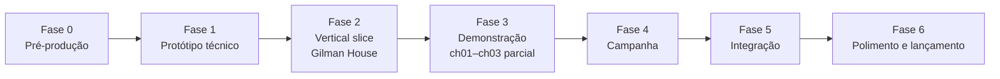

# 20 — Roadmap de desenvolvimento

> Fases progressivas com **gates**. Uma fase só termina quando seu gate é aprovado com evidências; arquivos existentes não bastam. Esforço é relativo (**P** pequeno, **M** médio, **G** grande, **GG** muito grande) e não é prazo. Nenhuma data é fixada: a velocidade real será medida após a Fase 1.

## Visão geral

| Fase | Esforço relativo | Gate |
|---|---|---|
| 0 Pré-produção | M | Documentação aprovada pelo responsável humano + decisões Q críticas respondidas |
| 1 Protótipo técnico | M | Sistemas mínimos validados em cena isolada e no export Windows |
| 2 Vertical slice | G | Sequência do hotel completa em qualidade-alvo, playtestada |
| 3 Demonstração | G | Demo externa estável, legal e playtestada |
| 4 Campanha | GG | Oito capítulos jogáveis de ponta a ponta |
| 5 Integração | G | Assets finais, áudio, UI e otimização integrados |
| 6 Polimento e lançamento | G | Release candidate aprovado nos critérios de qualidade e licenças |

---

## Fase 0 — Pré-produção

**Objetivos:** revisão do conto, definição narrativa, escolha da engine, escopo, documentação, direção artística, riscos.

**Entregáveis:** documentos `00`–`27`, `CLAUDE.md`, `AGENTS.md`, `README.md`; respostas às questões críticas de `26-DECISOES-PENDENTES.md` (Q-001, Q-002, Q-003, Q-005, Q-010, Q-013); quadro de referência visual montado por humano; orçamento indicativo de assets.

**Dependências:** nenhuma.

**Critérios de aceitação:**
* Todos os capítulos `ch00`–`ch08` têm ficha completa (05).
* Mapa (06), roteiro (04), mecânicas (12), backlog (21) e inventário (18) usam os mesmos IDs do registro (27).
* Cada elemento narrativo relevante tem marca C/I/O.
* Riscos com dono e critério de corte (22).

**Riscos:** documentação extensa demais para manter; decisões jurídicas adiadas; tom do epílogo mal compreendido.

**Esforço:** M (documental já produzido; restam revisões humanas `INN-000`–`INN-006`).

**Gate:** revisão humana registrada em `docs/decisions/` + autorização explícita para iniciar a Fase 1.

---

## Fase 1 — Protótipo técnico

**Objetivos:** validar, em uma cena pequena e cinza, os sistemas mínimos: movimento, câmera, interação, colisão, áudio espacial, renderização retrô, perfis de iluminação, sequência simples, salvamento por checkpoint, pausa, opções essenciais.

**Entregáveis:**
* Projeto Godot 4.7.2 configurado (Compatibility, Windows), estrutura de pastas de 17 §6.
* `sys_player`, `sys_camera`, `sys_interaction`, `sys_settings` (mínimo), `sys_retro_render`, `sys_time_of_day` (2 perfis), `sys_audio` (zonas + emissor), `sys_subtitles`, `sys_sequence` (passos básicos), `sys_story_state`, `sys_save`, `sys_ui` (pausa, prompt, leitor).
* Cena de teste "rua e quarto": um quarteirão de rua cinza com uma porta, escada e um quarto — sem conteúdo narrativo final.
* Spikes `INN-013`, `INN-016`, `INN-017`, `INN-030` documentados.
* Export Windows executado graficamente com relatório.

**Dependências:** gate da Fase 0.

**Critérios de aceitação:**
* Movimento e câmera consistentes em 30, 60 e 144 FPS (medidos).
* Todos os efeitos retrô desligáveis; UI e legendas nítidas em resolução nativa.
* Save/load de checkpoint com backup e recuperação de corrupção testados headless.
* Pausa congela sequência, áudio de evento e temporizadores.
* Nenhum autoload por sistema; UI sem concessões (revisão de contrato).

**Riscos:** limitação do renderizador Compatibility para a noite; travadas no streaming; dívida por reaproveitar código sem auditoria (Q-005).

**Esforço:** M.

**Gate:** relatório `docs/qa/fase1-prototipo.md` com testes executados, capturas do export e lista de limitações; aprovação humana da aparência retrô.

---

## Fase 2 — Vertical slice

### Comparação dos candidatos

| Critério | Primeira exploração (ch02–ch03) | Zadok Allen (ch04) | **Gilman House (ch05–ch06)** | Início da fuga noturna (ch07) |
|---|---|---|---|---|
| Impacto emocional | Médio (estranhamento) | Alto, mas dependente de texto/voz | **Muito alto** | Alto |
| Representatividade de sistemas | Exploração, NPCs, mapa | Diálogo, sequência, luz | **Interação, móveis, sequência, perigo, checkpoint, áudio, luz interior/noite, cidade vista da janela** | Furtividade, IA, streaming |
| Custo de ambiente | **Alto** (vários distritos) | Baixo (um cais) | **Moderado** (andar do hotel + telhado + pátio) | Alto (bairro sul + vistas) |
| Dependência de assets finais difíceis | Muitos NPCs | Voz de Zadok | Poucos personagens visíveis | Grupos de perseguidores |
| Risco técnico que reduz | Streaming | Pouco | **Diretor de cerco, justiça de checkpoints, móveis físicos** | Percepção |
| Mostra a identidade de Innsmouth | Sim | Parcial | Sim, pelo prelúdio na praça e pela vista da janela | Sim |

**Escolha (D-009):** Gilman House — do prelúdio na `dist_square` ao crepúsculo (`evt_gilman_crowd`, `evt_bus_breakdown`) até sair pelo prédio da Washington (`pz09_courtyard`). É a sequência que o conto descreve com maior precisão espacial, a mais memorável e a que mais exige acabamento; se ela não funcionar, o projeto precisa ser repensado cedo.

**Objetivos:** demonstrar a qualidade-alvo de arte, luz, áudio, interação e tensão num trecho de ~25–35 min.

**Entregáveis:** `lvl_gilman_interior`, `lvl_gilman_exterior_escape`, fachada e praça (`dist_square` parcial), `pz05_bolt`–`pz09_courtyard`, `SiegeDirector`, checkpoints `cp05_return`–`cp06_courtyard`, eventos `evt_gilman_crowd`→`evt_courtyard_crowd`, áudio dos perseguidores, arte em qualidade-alvo para o andar do hotel (pode usar personagens provisórios), relatório de playtest.

**Dependências:** gate da Fase 1; textos de ch05–ch06 aprovados (04); planta do hotel (08).

**Critérios de aceitação:**
* Concluível em todas as rotas válidas; nenhuma captura "injusta" (morte sem aviso audível **e** legendado).
* Após captura, retorno ao checkpoint em ≤ 10 s de espera (medido) sem repetir falas longas.
* Testes headless do `SiegeDirector` com jogador simulado (ótimo, lento, errado).
* Playtest com ≥ 5 pessoas (23 §4): ao menos 4 de 5 descrevem a sequência como tensa e compreensível (meta, não resultado).

**Riscos:** física de móveis instável; dificuldade mal calibrada; som insuficiente sem mixagem profissional.

**Esforço:** G.

**Gate:** relatório `docs/qa/vertical-slice.md` + decisão humana de "seguir / ajustar / reduzir escopo".

---

## Fase 3 — Demonstração jogável

**Objetivos:** experiência curta, polida, adequada a testes externos e divulgação: ch01 completo, ch02 completo e ch03 até receber o mapa do rapaz da mercearia (~40–50 min, hipótese).

**Entregáveis:** `lvl_toledo_room` (abertura `ch00_frame`), níveis de Newburyport, `lvl_bus`, `dist_square`, `dist_gorge` e trechos de `dist_north` vistos do ônibus; `lvl_grocery`; `pz01_tilton`; documentos de ch01; menu principal, configurações e acessibilidade completos para esse trecho; tela final de demo; build Windows (assinatura de código do executável decidida em Q-019); textos em PT-BR (e EN se Q-003).

**Dependências:** gate da Fase 2; Q-002 e Q-008 respondidas.

**Critérios de aceitação:** demo sem bloqueios em 3 execuções completas por testadores; desempenho dentro das metas de 19 no hardware mínimo medido; inventário de assets 100% com licença verificada para tudo o que está na demo.

**Riscos:** exploração inicial lenta demais; expectativa de "jogo de perseguição" frustrada; vazamento de spoilers.

**Esforço:** G.

**Gate:** aprovação humana para distribuição restrita (playtest fechado) e, separadamente, para publicação pública.

---

## Fase 4 — Produção da campanha

Entregas progressivas, cada uma com mini-gate "capítulo jogável de ponta a ponta com placeholders aprovados":

| Entrega | Capítulos | Dependências principais | Esforço |
|---|---|---|---|
| 4.1 | ch03 restante (tour, `pz02`, `pz03`) | streaming de distritos (`INN-030`), `sys_npc_routine` | G |
| 4.2 | ch04 Zadok | `sys_dialogue` com temas; voz Q-007 | M |
| 4.3 | ch05–ch06 integrados à campanha | vertical slice | P |
| 4.4 | ch07 fuga noturna | `PatrolDirector`, `sys_perception`, `dist_south_residential`, `dist_bank_station`, `lvl_railway_marsh`, multidão | GG |
| 4.5 | ch08 epílogo | `pz12_genealogy`, sonhos, cena final | G |
| 4.6 | Fio contínuo ch00→ch08 | todos | M |

**Critérios de aceitação:** cada capítulo completável a partir da seleção de capítulo e a partir de save contínuo; checklist de eventos únicos (05) verificado; fidelidade revisada (02).

**Riscos:** crescimento de ch07; repetição visual; epílogo percebido como apêndice.

**Gate:** jogo inteiro completável com placeholders; playtest de campanha completa com ≥ 3 pessoas.

---

## Fase 5 — Integração

**Objetivos:** revisão narrativa, integração de assets finais, animações, áudio e mixagem, interface final, ajustes de progressão, otimização.

**Entregáveis:** assets finais aprovados (18), mixagem, localização, otimização com perfis medidos (19), versão "beta de conteúdo completo".

**Dependências:** Fase 4; contratos de arte/áudio (Q-012).

**Critérios de aceitação:** nenhum placeholder `ph_` na build; metas de desempenho medidas; legendas completas; revisão de sensibilidade (Q-013) concluída.

**Riscos:** atrasos de terceiros; regressões de desempenho ao trocar placeholders.

**Esforço:** G.

**Gate:** beta aprovada para playtest amplo.

---

## Fase 6 — Polimento e lançamento

**Objetivos:** playtests, correções, testes de regressão, revisão de acessibilidade, validação de licenças, preparação da distribuição.

**Entregáveis:** release candidate; página de loja preparada para revisão humana (sem publicar); créditos e avisos de terceiros; aviso de conteúdo; pacote de imprensa revisável.

**Dependências:** Fase 5; Q-002, Q-009, Q-015 respondidas; parecer jurídico.

**Critérios de aceitação:** matriz de qualidade (23) sem falhas bloqueantes; inventário de licenças completo; teste de instalação limpa em 3 máquinas; saves migráveis entre versões beta e RC.

**Riscos:** problemas de certificação/políticas de loja; bugs de progressão tardios.

**Esforço:** G.

**Gate:** decisão humana de lançamento. Claude Code não publica nem envia builds.
